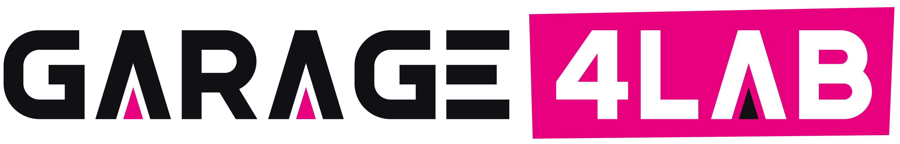

  <picture>
    <source media="(prefers-color-scheme: dark)" srcset="assets/logos/garage4lab-logo-on-dark.png">
    
  </picture>

<h3 align="center">Arquitetura que vira resultado.</h3>

<b>AI First. Rápido para aprender, rigoroso para escalar.</b>

  <code>AI FIRST</code> ▲ <code>AGENTES</code> ▲ <code>ARQUITETURA</code> ▲ <code>MULTICLOUD</code> ▲ <code>SQUADS</code> ▲ <code>SRE</code>

---

**A estratégia que a diretoria aprova raramente é o sistema que roda em produção.** A Garage4Lab existe para
fechar essa distância.

Somos uma consultoria **AI First** de arquitetura de soluções, agentes de IA, squads ágeis e multicloud.
Diagnosticamos o problema de negócio, colocamos um protótipo funcionando com dados reais em dias, provamos
valor com métrica de negócio e só então escalamos, com arquitetura e governança.

> Não vendemos tecnologia. Entregamos **decisões bem tomadas e sistemas que chegam à produção**.

## O problema que resolvemos

A maioria dos projetos de tecnologia não falha por falta de ferramenta. Falha porque:

- **ninguém fez a pergunta certa no começo**, e o projeto resolve o problema errado com perfeição;
- **a decisão difícil foi adiada**, e o custo dela cresceu a cada mês;
- **se gastou um ano planejando** o que poderia ter sido testado em semanas.

Com a IA, a distância só aumenta: muita prova de conceito, pouca coisa em produção e quase nenhum número
que a diretoria consiga defender.

## Quem somos

A Garage4Lab nasce da experiência de quem passou anos liderando tecnologia **do lado do cliente**: com
orçamento apertado, prazo de go-live, operação 24x7 e diretoria perguntando "quanto isso gera?".

O nome resume o jeito de trabalhar. A **garagem** é onde se testa rápido. O **laboratório** é onde se ganha
método. O cliente só vê valor quando a solução entra em produção, e é aí que o nosso trabalho termina.

## Nossos pilares

| | Pilar | O que significa para o cliente |
|---|---|---|
| **( 01 )** | **Pensamos como executivos** | Toda recomendação começa pelo impacto no negócio: quanto gera, quanto custa, quanto arrisca e quem decide. |
| **( 02 )** | **Desenhamos como arquitetos** | Arquitetura é decisão, não diagrama. Você recebe opções, trade-offs e as decisões que dependem de você, com dono e prazo. |
| **( 03 )** | **Experimentamos como uma garagem** | Protótipo funcionando com dados reais em dias, não em meses. O que não prova valor é encerrado cedo e sem apego. |
| **( 04 )** | **Entregamos como quem já respondeu pela operação** | Segurança, custo, observabilidade e governança desde o primeiro caso que vai para produção. |

Por baixo dos quatro, uma escolha: **AI First**. Antes de desenhar um processo, um sistema ou um time,
perguntamos o que a IA generativa e os agentes mudam nele. A IA é a primeira camada de cada solução, não um
projeto ao lado do negócio.

## Onde atuamos

| Frente | O que entregamos | Quando faz sentido |
|---|---|---|
| **Estratégia e adoção AI First** | Trilha de maturidade da produtividade individual aos agentes em processos de negócio, com portfólio de casos priorizado por ROI, governança e capacitação. | A empresa tem muitas iniciativas de IA e nenhum número para mostrar. |
| **Agentes e IA generativa em produção** | Agentes, assistentes e automações integrados aos sistemas que você já tem, em arquitetura multimodelo e multicloud. | O piloto funcionou na demonstração e travou na integração. |
| **Arquitetura de soluções e multicloud** | Plataformas e integrações preparadas para IA, com decisões de custo, risco e escala explícitas. | A arquitetura atual não suporta o que a estratégia pede, ou ninguém sabe quanto ela custa de verdade. |
| **Squads ágeis por jornada** | Times que combinam pessoas e agentes em torno de jornadas de negócio, com metas de resultado e não de entrega de tarefas. | O time entrega muito e o indicador de negócio não se mexe. |
| **Operação e confiabilidade** | Evolução de AMS para SRE, com indicadores de negócio por jornada crítica e IA aplicada à própria operação. | A sustentação consome o orçamento e o incidente ainda chega antes do alerta. |

## Como trabalhamos: o método da garagem

Quatro passos, em ciclos curtos. Cada um termina numa decisão, não num relatório.

| Passo | O que acontece | Você sai com |
|---|---|---|
| **( 01 ) Diagnosticar** | O problema de negócio, o indicador que importa e onde a IA muda o jogo. | Uma hipótese clara e mensurável |
| **( 02 ) Prototipar** | Uma solução funcional, com dados reais. | Um protótipo em dias, não em meses |
| **( 03 ) Provar** | Usuários reais e métrica de negócio. | A decisão de seguir, ajustar ou encerrar |
| **( 04 ) Escalar** | Arquitetura, segurança, custo e operação. | Produção com confiança |

**Errar rápido e barato faz parte do método. Errar caro e tarde, não.**

## No que acreditamos

1. **AI First por padrão.** Todo problema começa pela pergunta "como a IA muda isto?".
2. **Problema antes da ferramenta.** Nenhuma recomendação sai sem diagnóstico.
3. **Faça rápido, aprenda rápido.** Uma semana de teste real vale mais que um mês de debate.
4. **Rápido para aprender, rigoroso para escalar.** Velocidade na descoberta, disciplina na escala.
5. **Valor de negócio é a métrica.** Cada caso de IA tem ROI e dono.
6. **Arquitetura é decisão, não diagrama.** Multicloud e multimodelo, sem amarração a um único fornecedor.
7. **Pessoas e modelo operacional decidem o resultado.** IA que ninguém adota não entrega nada.
8. **Pensamento crítico como serviço.** Questionamos premissas, fornecedores, modismos e até o pedido inicial. É para isso que nos contratam.

## Para quem

Diretoria e liderança de tecnologia de empresas que precisam transformar estratégia de tecnologia em
resultado de negócio. Faz sentido conversar se você reconhece pelo menos um destes sinais:

- a diretoria aprovou uma estratégia de IA e você ainda não tem um caso em produção para mostrar;
- há pilotos demais e nenhum critério claro para decidir qual escala e qual morre;
- a arquitetura virou o gargalo de tudo que o negócio pede;
- o custo de sustentação cresce mais rápido que o valor entregue;
- você precisa de alguém que diga o que precisa ser dito, não o que é confortável ouvir.

## Por que a Garage4Lab

- **Já estivemos do seu lado da mesa.** Sabemos o que é responder pela operação, pelo orçamento e pelo prazo.
- **AI First de verdade.** A IA entra no desenho desde o primeiro dia, não como um projeto paralelo.
- **Protótipo antes do slide.** Você vê a solução funcionando com os seus dados antes de decidir investir.
- **Sem amarração.** Multicloud e multimodelo: a recomendação serve ao seu negócio, não a um fornecedor.
- **Decisões às claras.** Números antes de adjetivos, riscos expostos e cada próxima decisão com dono e data.
- **Integridade.** Falamos o que o cliente precisa ouvir, não o que ele quer ouvir.

## Vamos conversar

Traga um problema de negócio, não um pedido de ferramenta. A primeira conversa é um diagnóstico: saímos dela
com a pergunta certa, o indicador que importa e o primeiro protótipo que vale a pena testar.

---

Garage4Lab · Arquitetura que vira resultado.

